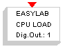

# File:Easylab cpuload gpout.png

[Download original file](../assets/uploads/Easylab_cpuload_gpout--c793802d8a.png)

Original upload: **Erikadds**, 2011-10-13T14:00:56Z; 750 bytes; `image/png`.

---

## Archive provenance

- [Original page](http://erika.tuxfamily.org/wiki/index.php?title=File%3AEasylab_cpuload_gpout.png) · [Archived source revision 3825](http://erika.tuxfamily.org/wiki/index.php?oldid=3825)
- Last source edit: 2011-10-13T14:00:56Z. Source retrieved on 2026-11-06; Markdown conversion completed on 2026-11-07.
- Original contributors recorded in exported history: Erikadds.
- [Original MediaWiki source](../source/wikitext/2136.mediawiki) · [Original editing history](../source/history/batch-023.xml)
- [Attribution and licensing notice](../NOTICE.md). Original file-specific notices, where present, remain applicable.
