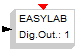

# File:Easylab output.png

[Download original file](../assets/uploads/Easylab_output--4c036d7e9b.png)

Original upload: **Erikadds**, 2011-09-28T11:23:48Z; 764 bytes; `image/png`.

---

## Archive provenance

- [Original page](http://erika.tuxfamily.org/wiki/index.php?title=File%3AEasylab_output.png) · [Archived source revision 3451](http://erika.tuxfamily.org/wiki/index.php?oldid=3451)
- Last source edit: 2011-09-28T11:23:48Z. Source retrieved on 2026-11-06; Markdown conversion completed on 2026-11-07.
- Original contributors recorded in exported history: Erikadds.
- [Original MediaWiki source](../source/wikitext/2086.mediawiki) · [Original editing history](../source/history/batch-023.xml)
- [Attribution and licensing notice](../NOTICE.md). Original file-specific notices, where present, remain applicable.
