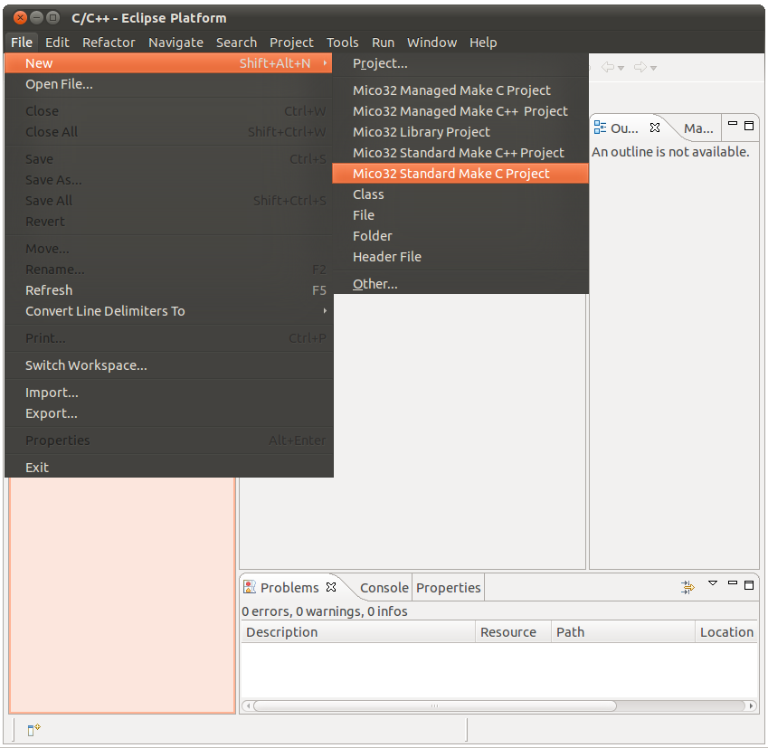

# File:Eclipse-standard-make-project.png

[Download original file](../assets/uploads/Eclipse-standard-make-project--1dcf64d3f3.png)

Original upload: **Ryosab81**, 2011-02-08T11:51:52Z; 124,512 bytes; `image/png`.

Upload comment: This screenshot shows the button which must be pressed to create a standard C project

This screenshot shows the button which must be pressed to create a standard C project

---

## Archive provenance

- [Original page](http://erika.tuxfamily.org/wiki/index.php?title=File%3AEclipse-standard-make-project.png) · [Archived source revision 2381](http://erika.tuxfamily.org/wiki/index.php?oldid=2381)
- Last source edit: 2011-02-08T11:51:52Z. Source retrieved on 2026-11-06; Markdown conversion completed on 2026-11-07.
- Original contributors recorded in exported history: Ryosab81.
- [Original MediaWiki source](../source/wikitext/1759.mediawiki) · [Original editing history](../source/history/batch-024.xml)
- [Attribution and licensing notice](../NOTICE.md). Original file-specific notices, where present, remain applicable.
