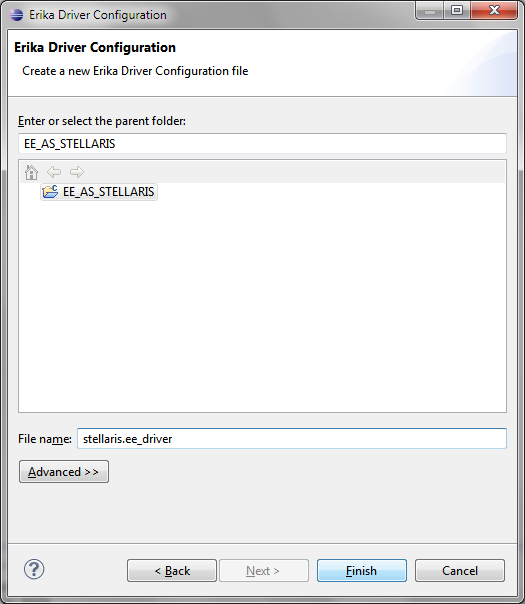

# File:Erika Driver Configuration File Name.png

[Download original file](../assets/uploads/Erika_Driver_Configuration_File_Name--123c32f423.png)

Original upload: **Eguidieri**, 2013-07-16T12:15:42Z; 28,034 bytes; `image/png`.

Upload comment: Erika Driver Configuration File Name

Erika Driver Configuration File Name

---

## Archive provenance

- [Original page](http://erika.tuxfamily.org/wiki/index.php?title=File%3AErika_Driver_Configuration_File_Name.png) · [Archived source revision 5178](http://erika.tuxfamily.org/wiki/index.php?oldid=5178)
- Last source edit: 2013-07-16T12:15:42Z. Source retrieved on 2026-11-06; Markdown conversion completed on 2026-11-07.
- Original contributors recorded in exported history: Eguidieri.
- [Original MediaWiki source](../source/wikitext/2371.mediawiki) · [Original editing history](../source/history/batch-024.xml)
- [Attribution and licensing notice](../NOTICE.md). Original file-specific notices, where present, remain applicable.
