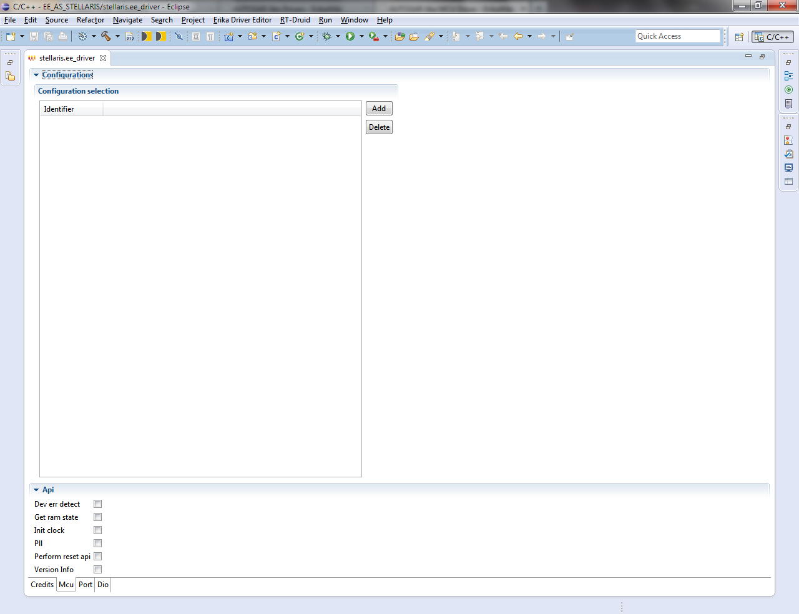

# File:Erika Driver Configurator MCU.png

[Download original file](../assets/uploads/Erika_Driver_Configurator_MCU--b90cbdeb40.png)

Original upload: **Giuseppe Serano**, 2013-07-16T13:34:59Z; 69,683 bytes; `image/png`.

Upload comment: Erika Driver Configurator MCU.

Erika Driver Configurator MCU.

---

## Archive provenance

- [Original page](http://erika.tuxfamily.org/wiki/index.php?title=File%3AErika_Driver_Configurator_MCU.png) · [Archived source revision 5197](http://erika.tuxfamily.org/wiki/index.php?oldid=5197)
- Last source edit: 2013-07-16T13:34:59Z. Source retrieved on 2026-11-06; Markdown conversion completed on 2026-11-07.
- Original contributors recorded in exported history: Giuseppe Serano.
- [Original MediaWiki source](../source/wikitext/2378.mediawiki) · [Original editing history](../source/history/batch-024.xml)
- [Attribution and licensing notice](../NOTICE.md). Original file-specific notices, where present, remain applicable.
