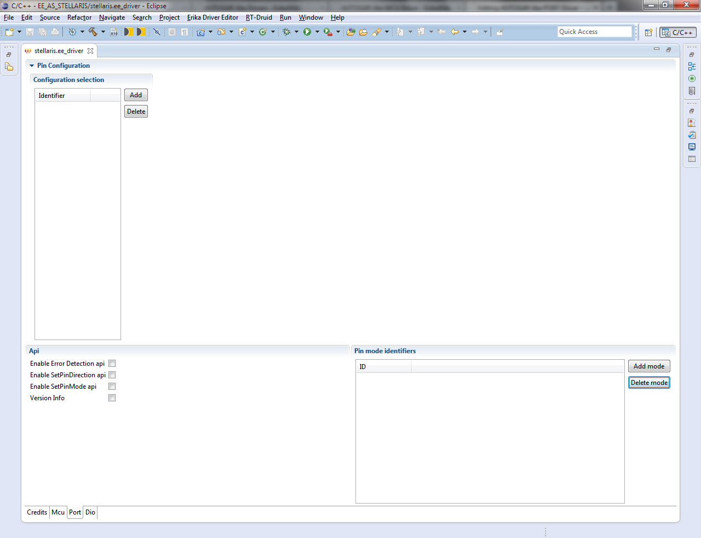

# File:Erika Driver Configurator PORT.png

[Download original file](../assets/uploads/Erika_Driver_Configurator_PORT--65489db8bc.png)

Original upload: **Giuseppe Serano**, 2013-07-16T16:33:00Z; 73,753 bytes; `image/png`.

Upload comment: Erika Driver Configurator PORT.

Erika Driver Configurator PORT.

---

## Archive provenance

- [Original page](http://erika.tuxfamily.org/wiki/index.php?title=File%3AErika_Driver_Configurator_PORT.png) · [Archived source revision 5213](http://erika.tuxfamily.org/wiki/index.php?oldid=5213)
- Last source edit: 2013-07-16T16:33:00Z. Source retrieved on 2026-11-06; Markdown conversion completed on 2026-11-07.
- Original contributors recorded in exported history: Giuseppe Serano.
- [Original MediaWiki source](../source/wikitext/2383.mediawiki) · [Original editing history](../source/history/batch-025.xml)
- [Attribution and licensing notice](../NOTICE.md). Original file-specific notices, where present, remain applicable.
