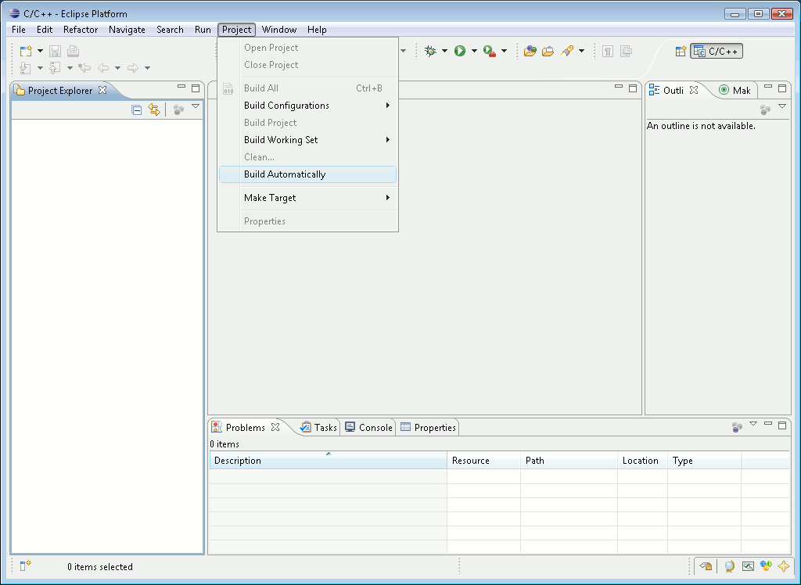

# File:Erikatutorial build automatically.png

[Download original file](../assets/uploads/Erikatutorial_build_automatically--659d7a5ae4.png)

Original upload: **Pj**, 2010-06-26T12:26:31Z; 15,579 bytes; `image/png`.

Upload comment: Deselect the ''Build Automatically'' flag in the ''Project'' menu.

Deselect the *Build Automatically* flag in the *Project* menu.

---

## Archive provenance

- [Original page](http://erika.tuxfamily.org/wiki/index.php?title=File%3AErikatutorial_build_automatically.png) · [Archived source revision 2022](http://erika.tuxfamily.org/wiki/index.php?oldid=2022)
- Last source edit: 2010-06-26T12:26:31Z. Source retrieved on 2026-11-06; Markdown conversion completed on 2026-11-07.
- Original contributors recorded in exported history: Pj.
- [Original MediaWiki source](../source/wikitext/1643.mediawiki) · [Original editing history](../source/history/batch-025.xml)
- [Attribution and licensing notice](../NOTICE.md). Original file-specific notices, where present, remain applicable.
