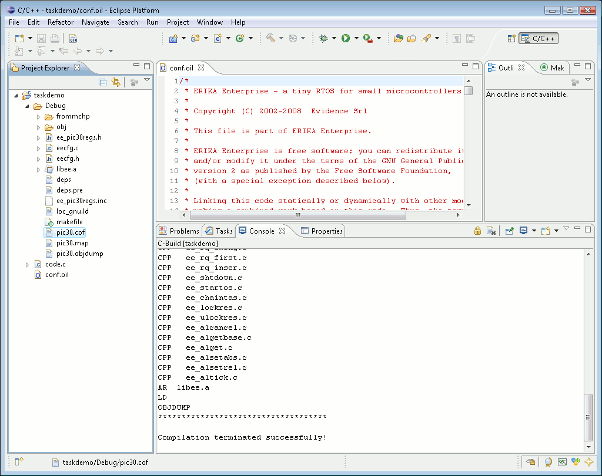

# File:Erikatutorial cof image.png

[Download original file](../assets/uploads/Erikatutorial_cof_image--1d74aaca54.png)

Original upload: **Pj**, 2010-06-26T12:28:51Z; 25,356 bytes; `image/png`.

Upload comment: The output file is ready to be programmed on the target board.

The output file is ready to be programmed on the target board.

---

## Archive provenance

- [Original page](http://erika.tuxfamily.org/wiki/index.php?title=File%3AErikatutorial_cof_image.png) · [Archived source revision 2029](http://erika.tuxfamily.org/wiki/index.php?oldid=2029)
- Last source edit: 2010-06-26T12:28:51Z. Source retrieved on 2026-11-06; Markdown conversion completed on 2026-11-07.
- Original contributors recorded in exported history: Pj.
- [Original MediaWiki source](../source/wikitext/1650.mediawiki) · [Original editing history](../source/history/batch-025.xml)
- [Attribution and licensing notice](../NOTICE.md). Original file-specific notices, where present, remain applicable.
