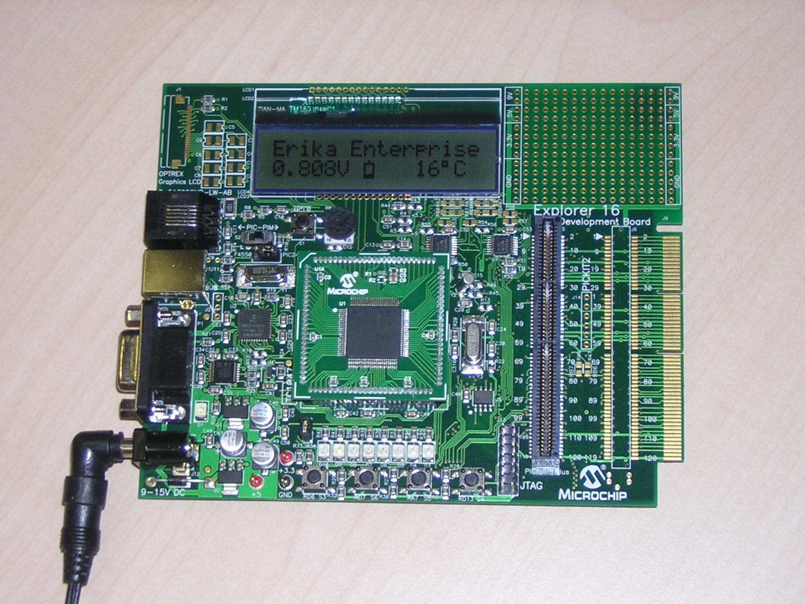

# File:Erikatutorial explorer16running.jpg

[Download original file](../assets/uploads/Erikatutorial_explorer16running--12395bfd8d.jpg)

Original upload: **Pj**, 2010-06-26T12:42:14Z; 401,143 bytes; `image/jpeg`.

Upload comment: The Explorer 16 board with the running demo program.

The Explorer 16 board with the running demo program.

---

## Archive provenance

- [Original page](http://erika.tuxfamily.org/wiki/index.php?title=File%3AErikatutorial_explorer16running.jpg) · [Archived source revision 2037](http://erika.tuxfamily.org/wiki/index.php?oldid=2037)
- Last source edit: 2010-06-26T12:42:14Z. Source retrieved on 2026-11-06; Markdown conversion completed on 2026-11-07.
- Original contributors recorded in exported history: Pj.
- [Original MediaWiki source](../source/wikitext/1656.mediawiki) · [Original editing history](../source/history/batch-025.xml)
- [Attribution and licensing notice](../NOTICE.md). Original file-specific notices, where present, remain applicable.
