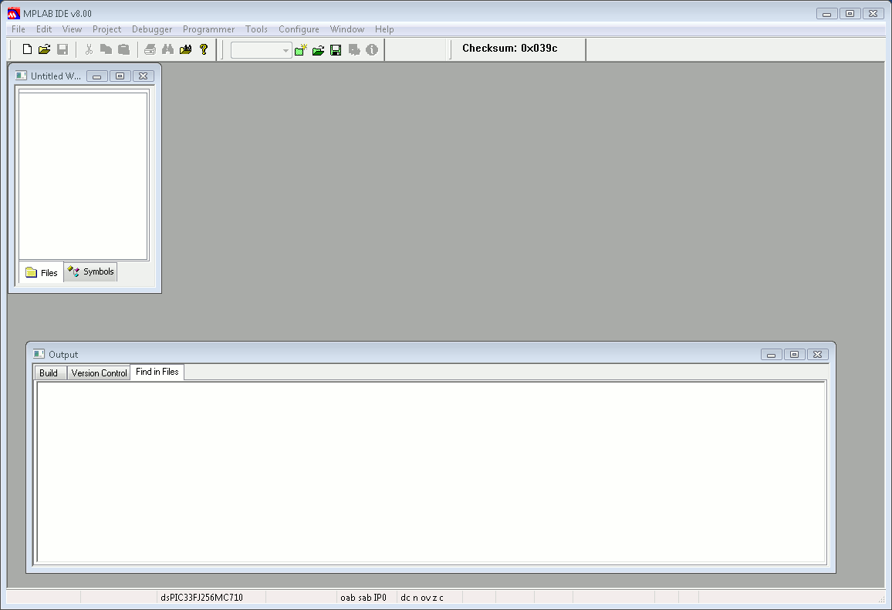

# File:Erikatutorial mplab1.png

[Download original file](../assets/uploads/Erikatutorial_mplab1--82a72b85d4.png)

Original upload: **Pj**, 2010-06-26T12:29:05Z; 9,437 bytes; `image/png`.

Upload comment: The Microchip MPLAB IDE.

The Microchip MPLAB IDE.

---

## Archive provenance

- [Original page](http://erika.tuxfamily.org/wiki/index.php?title=File%3AErikatutorial_mplab1.png) · [Archived source revision 2030](http://erika.tuxfamily.org/wiki/index.php?oldid=2030)
- Last source edit: 2010-06-26T12:29:05Z. Source retrieved on 2026-11-06; Markdown conversion completed on 2026-11-07.
- Original contributors recorded in exported history: Pj.
- [Original MediaWiki source](../source/wikitext/1651.mediawiki) · [Original editing history](../source/history/batch-025.xml)
- [Attribution and licensing notice](../NOTICE.md). Original file-specific notices, where present, remain applicable.
