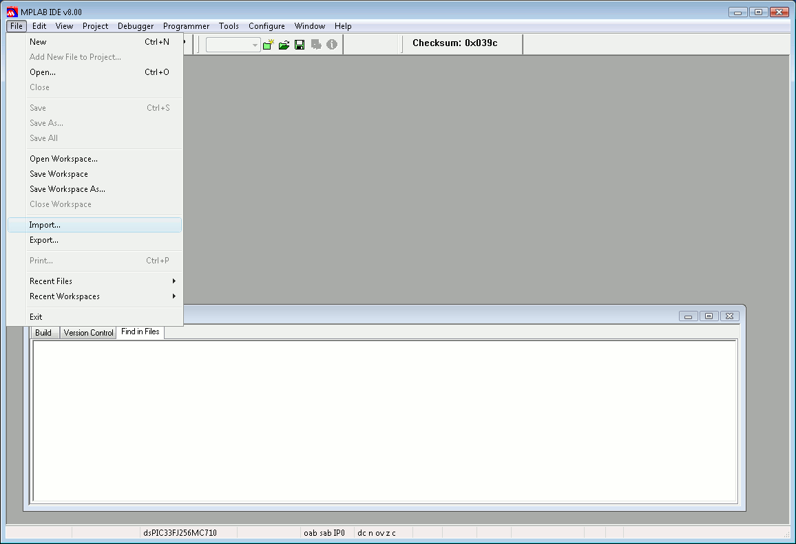

# File:Erikatutorial mplab2.png

[Download original file](../assets/uploads/Erikatutorial_mplab2--65f0dc0c2b.png)

Original upload: **Pj**, 2010-06-26T12:29:23Z; 10,137 bytes; `image/png`.

Upload comment: Choose ''Import...'' from the ''File'' menu to import the coff file produced in Eclipse.

Choose *Import...* from the *File* menu to import the coff file produced in Eclipse.

---

## Archive provenance

- [Original page](http://erika.tuxfamily.org/wiki/index.php?title=File%3AErikatutorial_mplab2.png) · [Archived source revision 2031](http://erika.tuxfamily.org/wiki/index.php?oldid=2031)
- Last source edit: 2010-06-26T12:29:23Z. Source retrieved on 2026-11-06; Markdown conversion completed on 2026-11-07.
- Original contributors recorded in exported history: Pj.
- [Original MediaWiki source](../source/wikitext/1652.mediawiki) · [Original editing history](../source/history/batch-025.xml)
- [Attribution and licensing notice](../NOTICE.md). Original file-specific notices, where present, remain applicable.
