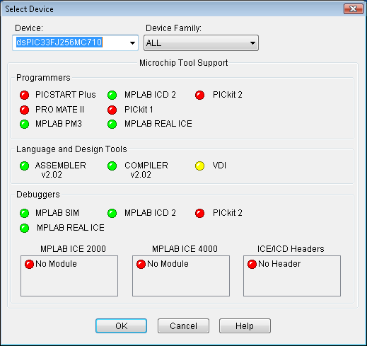

# File:Erikatutorial mplab selectdevice dspic.png

[Download original file](../assets/uploads/Erikatutorial_mplab_selectdevice_dspic--805f921371.png)

Original upload: **Pj**, 2010-06-26T12:39:50Z; 6,552 bytes; `image/png`.

Upload comment: Selecting the dsPIC MCU mounted on the FLEX boards.

Selecting the dsPIC MCU mounted on the FLEX boards.

---

## Archive provenance

- [Original page](http://erika.tuxfamily.org/wiki/index.php?title=File%3AErikatutorial_mplab_selectdevice_dspic.png) · [Archived source revision 2036](http://erika.tuxfamily.org/wiki/index.php?oldid=2036)
- Last source edit: 2010-06-26T12:39:50Z. Source retrieved on 2026-11-06; Markdown conversion completed on 2026-11-07.
- Original contributors recorded in exported history: Pj.
- [Original MediaWiki source](../source/wikitext/1655.mediawiki) · [Original editing history](../source/history/batch-026.xml)
- [Attribution and licensing notice](../NOTICE.md). Original file-specific notices, where present, remain applicable.
