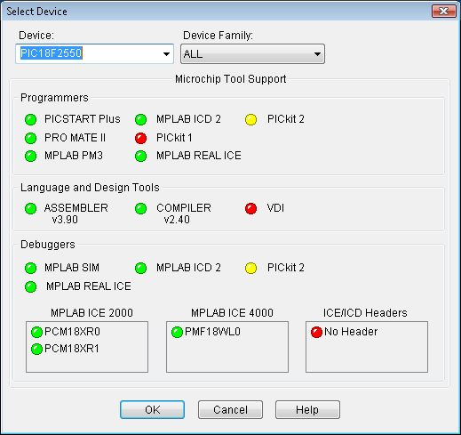

# File:Erikatutorial mplab selectdevice pic18.png

[Download original file](../assets/uploads/Erikatutorial_mplab_selectdevice_pic18--bf2e9f80cb.png)

Original upload: **Pj**, 2010-06-26T12:45:02Z; 6,641 bytes; `image/png`.

Upload comment: Selecting the PIC18 MCU mounted on the FLEX Full boards.

Selecting the PIC18 MCU mounted on the FLEX Full boards.

---

## Archive provenance

- [Original page](http://erika.tuxfamily.org/wiki/index.php?title=File%3AErikatutorial_mplab_selectdevice_pic18.png) · [Archived source revision 2039](http://erika.tuxfamily.org/wiki/index.php?oldid=2039)
- Last source edit: 2010-06-26T12:45:02Z. Source retrieved on 2026-11-06; Markdown conversion completed on 2026-11-07.
- Original contributors recorded in exported history: Pj.
- [Original MediaWiki source](../source/wikitext/1657.mediawiki) · [Original editing history](../source/history/batch-026.xml)
- [Attribution and licensing notice](../NOTICE.md). Original file-specific notices, where present, remain applicable.
