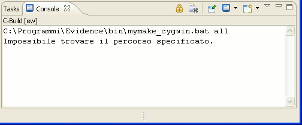

# File:Erikatutorial mymake cygwin error.png

[Download original file](../assets/uploads/Erikatutorial_mymake_cygwin_error--d03f1f270b.png)

Original upload: **Pj**, 2010-06-26T12:28:29Z; 4,064 bytes; `image/png`.

Upload comment: An error that shows up on some Windows machines. Please check the <tt>mymake_cygwin.bat</tt> file.

An error that shows up on some Windows machines. Please check the mymake\_cygwin.bat file.

---

## Archive provenance

- [Original page](http://erika.tuxfamily.org/wiki/index.php?title=File%3AErikatutorial_mymake_cygwin_error.png) · [Archived source revision 2028](http://erika.tuxfamily.org/wiki/index.php?oldid=2028)
- Last source edit: 2010-06-26T12:28:30Z. Source retrieved on 2026-11-06; Markdown conversion completed on 2026-11-07.
- Original contributors recorded in exported history: Pj.
- [Original MediaWiki source](../source/wikitext/1649.mediawiki) · [Original editing history](../source/history/batch-026.xml)
- [Attribution and licensing notice](../NOTICE.md). Original file-specific notices, where present, remain applicable.
