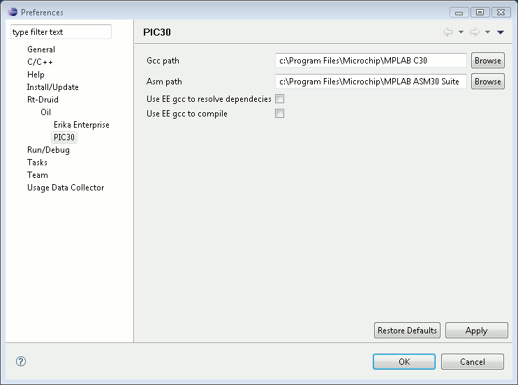

# File:Erikatutorial preferences pic30.png

[Download original file](../assets/uploads/Erikatutorial_preferences_pic30--31731afe1b.png)

Original upload: **Pj**, 2010-06-26T12:26:09Z; 7,529 bytes; `image/png`.

Upload comment: Select paths for compiler and assembler.

Select paths for compiler and assembler.

---

## Archive provenance

- [Original page](http://erika.tuxfamily.org/wiki/index.php?title=File%3AErikatutorial_preferences_pic30.png) · [Archived source revision 2021](http://erika.tuxfamily.org/wiki/index.php?oldid=2021)
- Last source edit: 2010-06-26T12:26:09Z. Source retrieved on 2026-11-06; Markdown conversion completed on 2026-11-07.
- Original contributors recorded in exported history: Pj.
- [Original MediaWiki source](../source/wikitext/1642.mediawiki) · [Original editing history](../source/history/batch-026.xml)
- [Attribution and licensing notice](../NOTICE.md). Original file-specific notices, where present, remain applicable.
