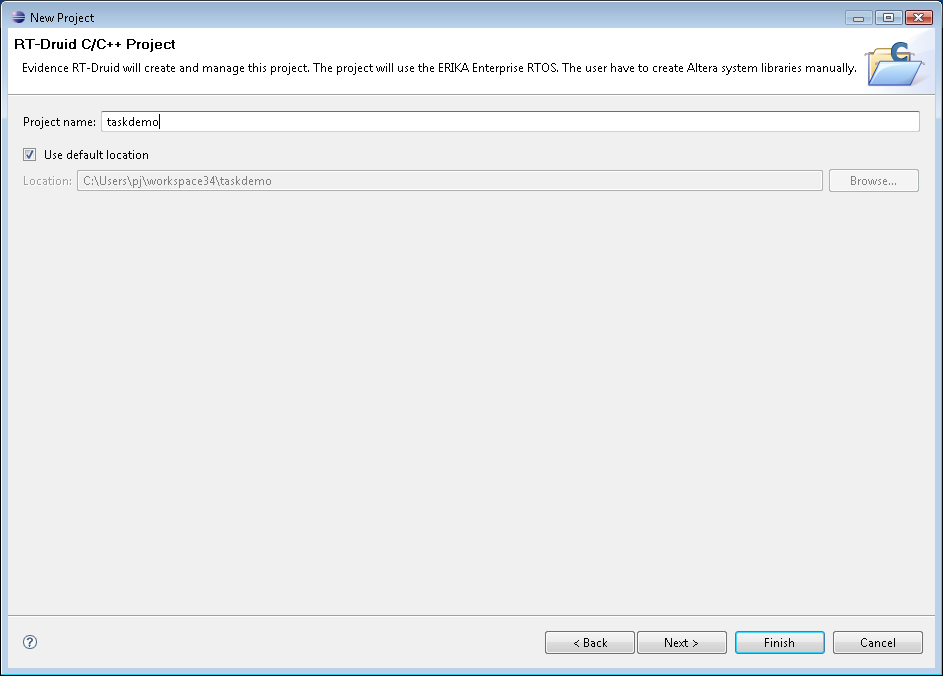

# File:Erikatutorial projectname.png

[Download original file](../assets/uploads/Erikatutorial_projectname--5245bbf04b.png)

Original upload: **Pj**, 2010-06-26T12:27:32Z; 16,592 bytes; `image/png`.

Upload comment: Type a name for the new project.

Type a name for the new project.

---

## Archive provenance

- [Original page](http://erika.tuxfamily.org/wiki/index.php?title=File%3AErikatutorial_projectname.png) · [Archived source revision 2025](http://erika.tuxfamily.org/wiki/index.php?oldid=2025)
- Last source edit: 2010-06-26T12:27:32Z. Source retrieved on 2026-11-06; Markdown conversion completed on 2026-11-07.
- Original contributors recorded in exported history: Pj.
- [Original MediaWiki source](../source/wikitext/1646.mediawiki) · [Original editing history](../source/history/batch-026.xml)
- [Attribution and licensing notice](../NOTICE.md). Original file-specific notices, where present, remain applicable.
