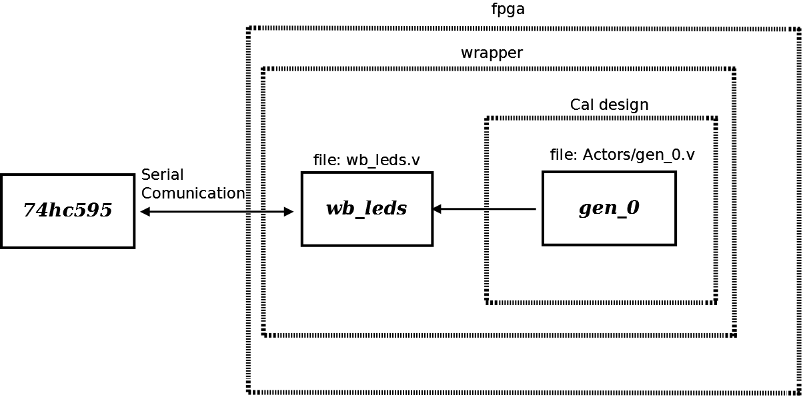

# File:Example3.png

[Download original file](../assets/uploads/Example3--a716332555.png)

Original upload: **Salva**, 2011-02-21T11:23:24Z; 65,498 bytes; `image/png`.

Example3 System Actor Leds with eigth bits number generator.

---

## Archive provenance

- [Original page](http://erika.tuxfamily.org/wiki/index.php?title=File%3AExample3.png) · [Archived source revision 2706](http://erika.tuxfamily.org/wiki/index.php?oldid=2706)
- Last source edit: 2011-02-21T11:23:24Z. Source retrieved on 2026-11-06; Markdown conversion completed on 2026-11-07.
- Original contributors recorded in exported history: Salva.
- [Original MediaWiki source](../source/wikitext/1774.mediawiki) · [Original editing history](../source/history/batch-026.xml)
- [Attribution and licensing notice](../NOTICE.md). Original file-specific notices, where present, remain applicable.
