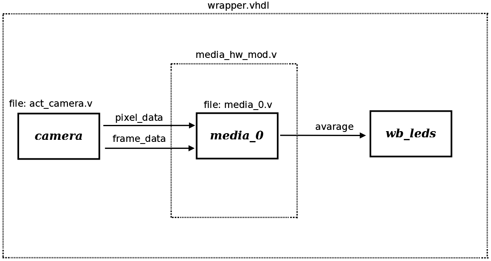

# File:Example7.png

[Download original file](../assets/uploads/Example7--3a89c26e50.png)

Original upload: **Salva**, 2011-02-21T11:15:11Z; 50,454 bytes; `image/png`.

Board Leds are turned on or off proportionally to the average image luminance

---

## Archive provenance

- [Original page](http://erika.tuxfamily.org/wiki/index.php?title=File%3AExample7.png) · [Archived source revision 2705](http://erika.tuxfamily.org/wiki/index.php?oldid=2705)
- Last source edit: 2011-02-21T11:15:11Z. Source retrieved on 2026-11-06; Markdown conversion completed on 2026-11-07.
- Original contributors recorded in exported history: Salva.
- [Original MediaWiki source](../source/wikitext/1777.mediawiki) · [Original editing history](../source/history/batch-026.xml)
- [Attribution and licensing notice](../NOTICE.md). Original file-specific notices, where present, remain applicable.
