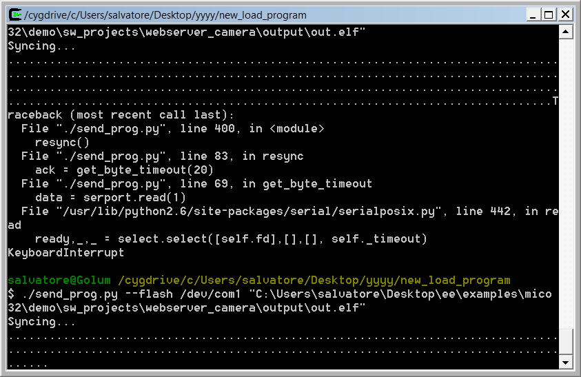

# File:FPG-EYE bootloader-script synchronization.png

[Download original file](../assets/uploads/FPG-EYE_bootloader-script_synchronization--aee26ae523.png)

Original upload: **Eguidieri**, 2011-10-07T15:35:39Z; 22,099 bytes; `image/png`.

---

## Archive provenance

- [Original page](http://erika.tuxfamily.org/wiki/index.php?title=File%3AFPG-EYE_bootloader-script_synchronization.png) · [Archived source revision 3750](http://erika.tuxfamily.org/wiki/index.php?oldid=3750)
- Last source edit: 2011-10-07T15:35:39Z. Source retrieved on 2026-11-06; Markdown conversion completed on 2026-11-07.
- Original contributors recorded in exported history: Eguidieri.
- [Original MediaWiki source](../source/wikitext/2124.mediawiki) · [Original editing history](../source/history/batch-026.xml)
- [Attribution and licensing notice](../NOTICE.md). Original file-specific notices, where present, remain applicable.
