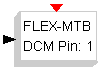

# File:Flex mtb dcm pwm.png

[Download original file](../assets/uploads/Flex_mtb_dcm_pwm--737cb5cc3c.png)

Original upload: **Erikadds**, 2010-11-11T09:16:11Z; 803 bytes; `image/png`.

---

## Archive provenance

- [Original page](http://erika.tuxfamily.org/wiki/index.php?title=File%3AFlex_mtb_dcm_pwm.png) · [Archived source revision 2134](http://erika.tuxfamily.org/wiki/index.php?oldid=2134)
- Last source edit: 2010-11-11T09:16:11Z. Source retrieved on 2026-11-06; Markdown conversion completed on 2026-11-07.
- Original contributors recorded in exported history: Erikadds.
- [Original MediaWiki source](../source/wikitext/1694.mediawiki) · [Original editing history](../source/history/batch-027.xml)
- [Attribution and licensing notice](../NOTICE.md). Original file-specific notices, where present, remain applicable.
