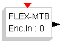

# File:Flex mtb encoder.png

[Download original file](../assets/uploads/Flex_mtb_encoder--8590679b3a.png)

Original upload: **Erikadds**, 2010-11-11T09:15:54Z; 808 bytes; `image/png`.

---

## Archive provenance

- [Original page](http://erika.tuxfamily.org/wiki/index.php?title=File%3AFlex_mtb_encoder.png) · [Archived source revision 2133](http://erika.tuxfamily.org/wiki/index.php?oldid=2133)
- Last source edit: 2010-11-11T09:15:54Z. Source retrieved on 2026-11-06; Markdown conversion completed on 2026-11-07.
- Original contributors recorded in exported history: Erikadds.
- [Original MediaWiki source](../source/wikitext/1693.mediawiki) · [Original editing history](../source/history/batch-027.xml)
- [Attribution and licensing notice](../NOTICE.md). Original file-specific notices, where present, remain applicable.
