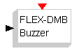

# File:Flex sinks dmbbuzzer.png

[Download original file](../assets/uploads/Flex_sinks_dmbbuzzer--662287bcc3.png)

Original upload: **Paolo.gai**, 2008-08-12T17:58:35Z; 442 bytes; `image/png`.

Upload comment: Scicos Block: Flex Demo board buzzer

Scicos Block: Flex Demo board buzzer

---

## Archive provenance

- [Original page](http://erika.tuxfamily.org/wiki/index.php?title=File%3AFlex_sinks_dmbbuzzer.png) · [Archived source revision 1292](http://erika.tuxfamily.org/wiki/index.php?oldid=1292)
- Last source edit: 2008-08-12T17:58:35Z. Source retrieved on 2026-11-06; Markdown conversion completed on 2026-11-07.
- Original contributors recorded in exported history: Paolo.gai.
- [Original MediaWiki source](../source/wikitext/1285.mediawiki) · [Original editing history](../source/history/batch-027.xml)
- [Attribution and licensing notice](../NOTICE.md). Original file-specific notices, where present, remain applicable.
