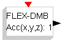

# File:Flex sources dmbacc.png

[Download original file](../assets/uploads/Flex_sources_dmbacc--0511516cb4.png)

Original upload: **Shiva**, 2008-08-13T11:11:48Z; 487 bytes; `image/png`.

---

## Archive provenance

- [Original page](http://erika.tuxfamily.org/wiki/index.php?title=File%3AFlex_sources_dmbacc.png) · [Archived source revision 1298](http://erika.tuxfamily.org/wiki/index.php?oldid=1298)
- Last source edit: 2008-08-13T11:11:48Z. Source retrieved on 2026-11-06; Markdown conversion completed on 2026-11-07.
- Original contributors recorded in exported history: Shiva.
- [Original MediaWiki source](../source/wikitext/1288.mediawiki) · [Original editing history](../source/history/batch-028.xml)
- [Attribution and licensing notice](../NOTICE.md). Original file-specific notices, where present, remain applicable.
