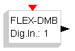

# File:Flex sources dmbdigin.png

[Download original file](../assets/uploads/Flex_sources_dmbdigin--4b9ef01094.png)

Original upload: **Shiva**, 2008-08-13T11:13:34Z; 440 bytes; `image/png`.

---

## Archive provenance

- [Original page](http://erika.tuxfamily.org/wiki/index.php?title=File%3AFlex_sources_dmbdigin.png) · [Archived source revision 1301](http://erika.tuxfamily.org/wiki/index.php?oldid=1301)
- Last source edit: 2008-08-13T11:13:34Z. Source retrieved on 2026-11-06; Markdown conversion completed on 2026-11-07.
- Original contributors recorded in exported history: Shiva.
- [Original MediaWiki source](../source/wikitext/1291.mediawiki) · [Original editing history](../source/history/batch-028.xml)
- [Attribution and licensing notice](../NOTICE.md). Original file-specific notices, where present, remain applicable.
