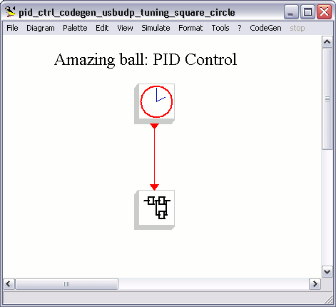

# File:Flexside schematic.png

[Download original file](../assets/uploads/Flexside_schematic--8e1e15b7e5.png)

Original upload: **Erikadds**, 2010-01-11T10:41:10Z; 12,335 bytes; `image/png`.

---

## Archive provenance

- [Original page](http://erika.tuxfamily.org/wiki/index.php?title=File%3AFlexside_schematic.png) · [Archived source revision 1873](http://erika.tuxfamily.org/wiki/index.php?oldid=1873)
- Last source edit: 2010-01-11T10:41:10Z. Source retrieved on 2026-11-06; Markdown conversion completed on 2026-11-07.
- Original contributors recorded in exported history: Erikadds.
- [Original MediaWiki source](../source/wikitext/1586.mediawiki) · [Original editing history](../source/history/batch-028.xml)
- [Attribution and licensing notice](../NOTICE.md). Original file-specific notices, where present, remain applicable.
