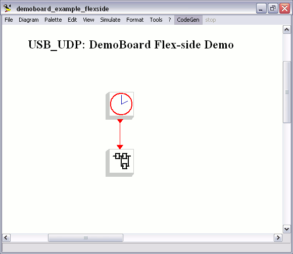

# File:Flexside scheme.png

[Download original file](../assets/uploads/Flexside_scheme--efd0dd2ea6.png)

Original upload: **Erikadds**, 2010-01-11T09:26:35Z; 14,969 bytes; `image/png`.

---

## Archive provenance

- [Original page](http://erika.tuxfamily.org/wiki/index.php?title=File%3AFlexside_scheme.png) · [Archived source revision 1849](http://erika.tuxfamily.org/wiki/index.php?oldid=1849)
- Last source edit: 2010-01-11T09:26:35Z. Source retrieved on 2026-11-06; Markdown conversion completed on 2026-11-07.
- Original contributors recorded in exported history: Erikadds.
- [Original MediaWiki source](../source/wikitext/1573.mediawiki) · [Original editing history](../source/history/batch-029.xml)
- [Attribution and licensing notice](../NOTICE.md). Original file-specific notices, where present, remain applicable.
