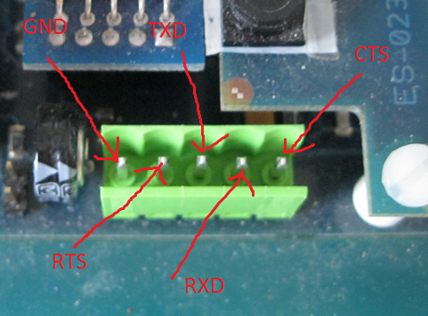

# File:Fpg-eye connettore seriale.png

[Download original file](../assets/uploads/Fpg-eye_connettore_seriale--10025bc619.png)

Original upload: **Eguidieri**, 2011-10-07T15:00:46Z; 289,333 bytes; `image/png`.

---

## Archive provenance

- [Original page](http://erika.tuxfamily.org/wiki/index.php?title=File%3AFpg-eye_connettore_seriale.png) · [Archived source revision 3735](http://erika.tuxfamily.org/wiki/index.php?oldid=3735)
- Last source edit: 2011-10-07T15:00:46Z. Source retrieved on 2026-11-06; Markdown conversion completed on 2026-11-07.
- Original contributors recorded in exported history: Eguidieri.
- [Original MediaWiki source](../source/wikitext/2121.mediawiki) · [Original editing history](../source/history/batch-029.xml)
- [Attribution and licensing notice](../NOTICE.md). Original file-specific notices, where present, remain applicable.
