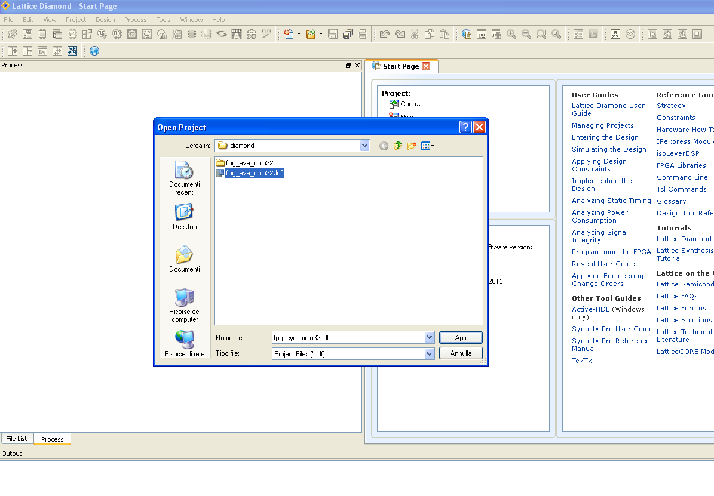

# File:Fpg eya mico32 from diamond.png

[Download original file](../assets/uploads/Fpg_eya_mico32_from_diamond--f2c1dc6d27.png)

Original upload: **Salva**, 2011-11-07T14:55:31Z; 87,167 bytes; `image/png`.

---

## Archive provenance

- [Original page](http://erika.tuxfamily.org/wiki/index.php?title=File%3AFpg_eya_mico32_from_diamond.png) · [Archived source revision 4081](http://erika.tuxfamily.org/wiki/index.php?oldid=4081)
- Last source edit: 2011-11-07T14:55:31Z. Source retrieved on 2026-11-06; Markdown conversion completed on 2026-11-07.
- Original contributors recorded in exported history: Salva.
- [Original MediaWiki source](../source/wikitext/2172.mediawiki) · [Original editing history](../source/history/batch-029.xml)
- [Attribution and licensing notice](../NOTICE.md). Original file-specific notices, where present, remain applicable.
