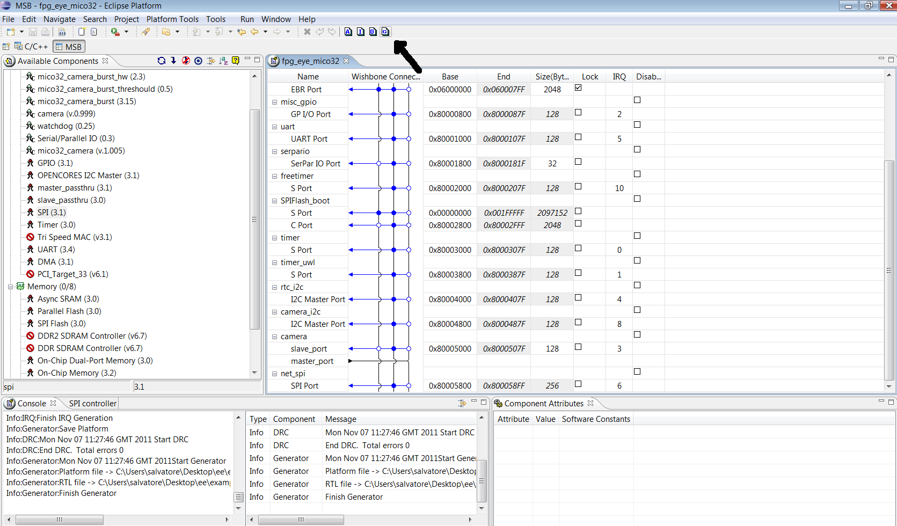

# File:Fpg eya mico32 from msb run.png

[Download original file](../assets/uploads/Fpg_eya_mico32_from_msb_run--9341e6fe27.png)

Original upload: **Salva**, 2011-11-07T11:38:10Z; 136,172 bytes; `image/png`.

---

## Archive provenance

- [Original page](http://erika.tuxfamily.org/wiki/index.php?title=File%3AFpg_eya_mico32_from_msb_run.png) · [Archived source revision 4042](http://erika.tuxfamily.org/wiki/index.php?oldid=4042)
- Last source edit: 2011-11-07T11:38:10Z. Source retrieved on 2026-11-06; Markdown conversion completed on 2026-11-07.
- Original contributors recorded in exported history: Salva.
- [Original MediaWiki source](../source/wikitext/2164.mediawiki) · [Original editing history](../source/history/batch-029.xml)
- [Attribution and licensing notice](../NOTICE.md). Original file-specific notices, where present, remain applicable.
