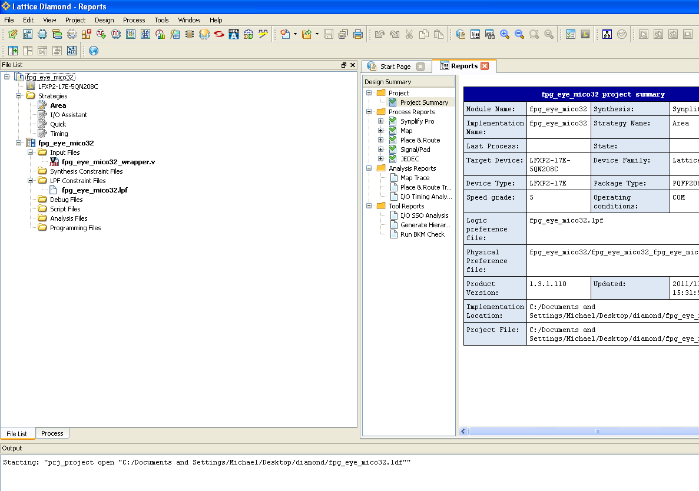

# File:Fpg eye mico32 wrapper active diamond.png

[Download original file](../assets/uploads/Fpg_eye_mico32_wrapper_active_diamond--1edf4ce29f.png)

Original upload: **Salva**, 2011-11-07T15:06:05Z; 90,773 bytes; `image/png`.

---

## Archive provenance

- [Original page](http://erika.tuxfamily.org/wiki/index.php?title=File%3AFpg_eye_mico32_wrapper_active_diamond.png) · [Archived source revision 4083](http://erika.tuxfamily.org/wiki/index.php?oldid=4083)
- Last source edit: 2011-11-07T15:06:05Z. Source retrieved on 2026-11-06; Markdown conversion completed on 2026-11-07.
- Original contributors recorded in exported history: Salva.
- [Original MediaWiki source](../source/wikitext/2173.mediawiki) · [Original editing history](../source/history/batch-029.xml)
- [Attribution and licensing notice](../NOTICE.md). Original file-specific notices, where present, remain applicable.
