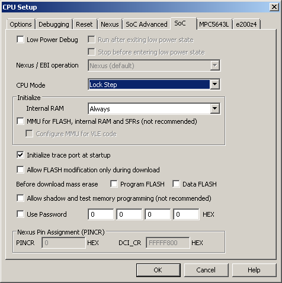

# File:ISystemCpuSetupLockStepMode.png

[Download original file](../assets/uploads/ISystemCpuSetupLockStepMode--96ad4ff906.png)

Original upload: **Antonio Marcello Catinella**, 2015-11-06T13:43:56Z; 13,446 bytes; `image/png`.

---

## Archive provenance

- [Original page](http://erika.tuxfamily.org/wiki/index.php?title=File%3AISystemCpuSetupLockStepMode.png) · [Archived source revision 6019](http://erika.tuxfamily.org/wiki/index.php?oldid=6019)
- Last source edit: 2015-11-06T13:43:56Z. Source retrieved on 2026-11-06; Markdown conversion completed on 2026-11-07.
- Original contributors recorded in exported history: Antonio Marcello Catinella.
- [Original MediaWiki source](../source/wikitext/2522.mediawiki) · [Original editing history](../source/history/batch-031.xml)
- [Attribution and licensing notice](../NOTICE.md). Original file-specific notices, where present, remain applicable.
