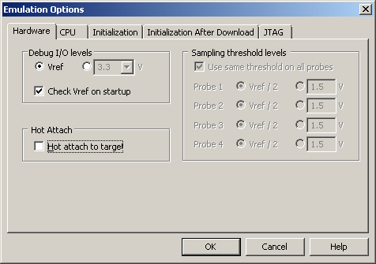

# File:ISystemHardware.png

[Download original file](../assets/uploads/ISystemHardware--bf06196c7f.png)

Original upload: **Antonio Marcello Catinella**, 2015-11-06T11:43:39Z; 10,596 bytes; `image/png`.

---

## Archive provenance

- [Original page](http://erika.tuxfamily.org/wiki/index.php?title=File%3AISystemHardware.png) · [Archived source revision 6013](http://erika.tuxfamily.org/wiki/index.php?oldid=6013)
- Last source edit: 2015-11-06T11:43:39Z. Source retrieved on 2026-11-06; Markdown conversion completed on 2026-11-07.
- Original contributors recorded in exported history: Antonio Marcello Catinella.
- [Original MediaWiki source](../source/wikitext/2518.mediawiki) · [Original editing history](../source/history/batch-031.xml)
- [Attribution and licensing notice](../NOTICE.md). Original file-specific notices, where present, remain applicable.
