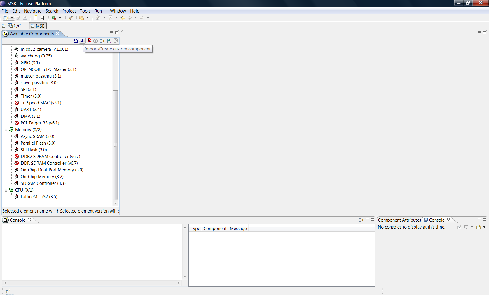

# File:Import create custom component.png

[Download original file](../assets/uploads/Import_create_custom_component--efad804e6f.png)

Original upload: **Salva**, 2011-09-28T16:17:18Z; 85,987 bytes; `image/png`.

---

## Archive provenance

- [Original page](http://erika.tuxfamily.org/wiki/index.php?title=File%3AImport_create_custom_component.png) · [Archived source revision 3497](http://erika.tuxfamily.org/wiki/index.php?oldid=3497)
- Last source edit: 2011-09-28T16:17:18Z. Source retrieved on 2026-11-06; Markdown conversion completed on 2026-11-07.
- Original contributors recorded in exported history: Salva.
- [Original MediaWiki source](../source/wikitext/2095.mediawiki) · [Original editing history](../source/history/batch-032.xml)
- [Attribution and licensing notice](../NOTICE.md). Original file-specific notices, where present, remain applicable.
