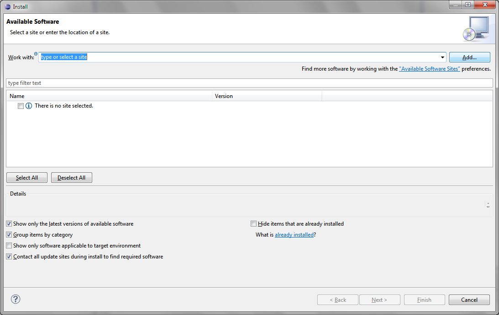

# File:Install Add.png

[Download original file](../assets/uploads/Install_Add--9fd837ea22.png)

Original upload: **Eguidieri**, 2013-07-16T09:32:51Z; 48,660 bytes; `image/png`.

Upload comment: Add Plug-in to install

Add Plug-in to install

---

## Archive provenance

- [Original page](http://erika.tuxfamily.org/wiki/index.php?title=File%3AInstall_Add.png) · [Archived source revision 5156](http://erika.tuxfamily.org/wiki/index.php?oldid=5156)
- Last source edit: 2013-07-16T09:32:51Z. Source retrieved on 2026-11-06; Markdown conversion completed on 2026-11-07.
- Original contributors recorded in exported history: Eguidieri.
- [Original MediaWiki source](../source/wikitext/2356.mediawiki) · [Original editing history](../source/history/batch-032.xml)
- [Attribution and licensing notice](../NOTICE.md). Original file-specific notices, where present, remain applicable.
