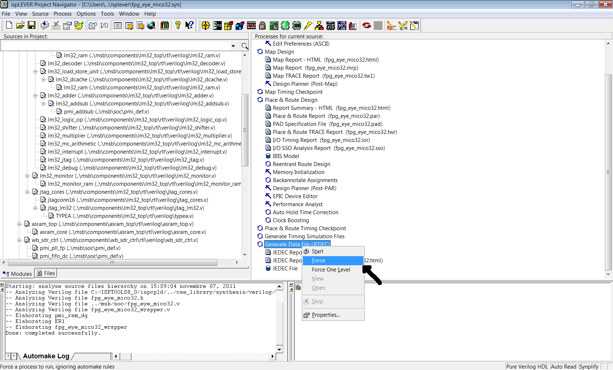

# File:Isp lever compile fpg eye mico32.png

[Download original file](../assets/uploads/Isp_lever_compile_fpg_eye_mico32--f1b28131a6.png)

Original upload: **Salva**, 2011-11-07T14:36:12Z; 144,298 bytes; `image/png`.

---

## Archive provenance

- [Original page](http://erika.tuxfamily.org/wiki/index.php?title=File%3AIsp_lever_compile_fpg_eye_mico32.png) · [Archived source revision 4073](http://erika.tuxfamily.org/wiki/index.php?oldid=4073)
- Last source edit: 2011-11-07T14:36:12Z. Source retrieved on 2026-11-06; Markdown conversion completed on 2026-11-07.
- Original contributors recorded in exported history: Salva.
- [Original MediaWiki source](../source/wikitext/2170.mediawiki) · [Original editing history](../source/history/batch-033.xml)
- [Attribution and licensing notice](../NOTICE.md). Original file-specific notices, where present, remain applicable.
