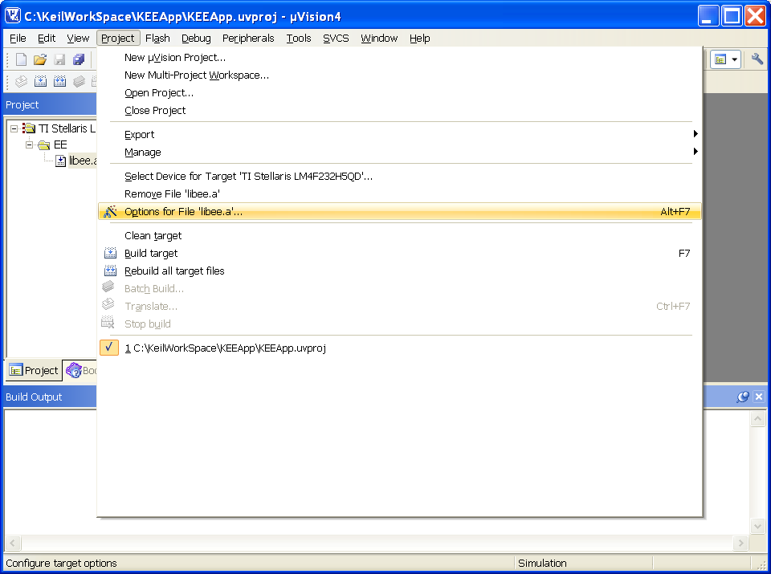

# File:KEEApp Options for File libee a.png

[Download original file](../assets/uploads/KEEApp_Options_for_File_libee_a--7d3f7bc100.png)

Original upload: **Outlawch**, 2012-02-01T13:41:41Z; 42,985 bytes; `image/png`.

---

## Archive provenance

- [Original page](http://erika.tuxfamily.org/wiki/index.php?title=File%3AKEEApp_Options_for_File_libee_a.png) · [Archived source revision 4604](http://erika.tuxfamily.org/wiki/index.php?oldid=4604)
- Last source edit: 2012-02-01T13:41:41Z. Source retrieved on 2026-11-06; Markdown conversion completed on 2026-11-07.
- Original contributors recorded in exported history: Outlawch.
- [Original MediaWiki source](../source/wikitext/2284.mediawiki) · [Original editing history](../source/history/batch-033.xml)
- [Attribution and licensing notice](../NOTICE.md). Original file-specific notices, where present, remain applicable.
