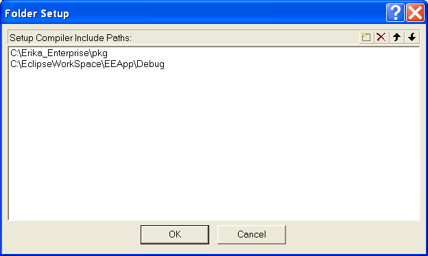

# File:KEEApp compiler inludes.png

[Download original file](../assets/uploads/KEEApp_compiler_inludes--9b3044594e.png)

Original upload: **Outlawch**, 2012-02-01T14:21:57Z; 10,641 bytes; `image/png`.

---

## Archive provenance

- [Original page](http://erika.tuxfamily.org/wiki/index.php?title=File%3AKEEApp_compiler_inludes.png) · [Archived source revision 4616](http://erika.tuxfamily.org/wiki/index.php?oldid=4616)
- Last source edit: 2012-02-01T14:21:57Z. Source retrieved on 2026-11-06; Markdown conversion completed on 2026-11-07.
- Original contributors recorded in exported history: Outlawch.
- [Original MediaWiki source](../source/wikitext/2292.mediawiki) · [Original editing history](../source/history/batch-034.xml)
- [Attribution and licensing notice](../NOTICE.md). Original file-specific notices, where present, remain applicable.
