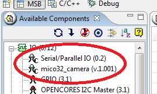

# File:LatticeMicoSystem import result.png

[Download original file](../assets/uploads/LatticeMicoSystem_import_result--a4f53cffd0.png)

Original upload: **Eguidieri**, 2011-09-30T11:57:33Z; 10,108 bytes; `image/png`.

---

## Archive provenance

- [Original page](http://erika.tuxfamily.org/wiki/index.php?title=File%3ALatticeMicoSystem_import_result.png) · [Archived source revision 3545](http://erika.tuxfamily.org/wiki/index.php?oldid=3545)
- Last source edit: 2011-09-30T11:57:33Z. Source retrieved on 2026-11-06; Markdown conversion completed on 2026-11-07.
- Original contributors recorded in exported history: Eguidieri.
- [Original MediaWiki source](../source/wikitext/2099.mediawiki) · [Original editing history](../source/history/batch-034.xml)
- [Attribution and licensing notice](../NOTICE.md). Original file-specific notices, where present, remain applicable.
