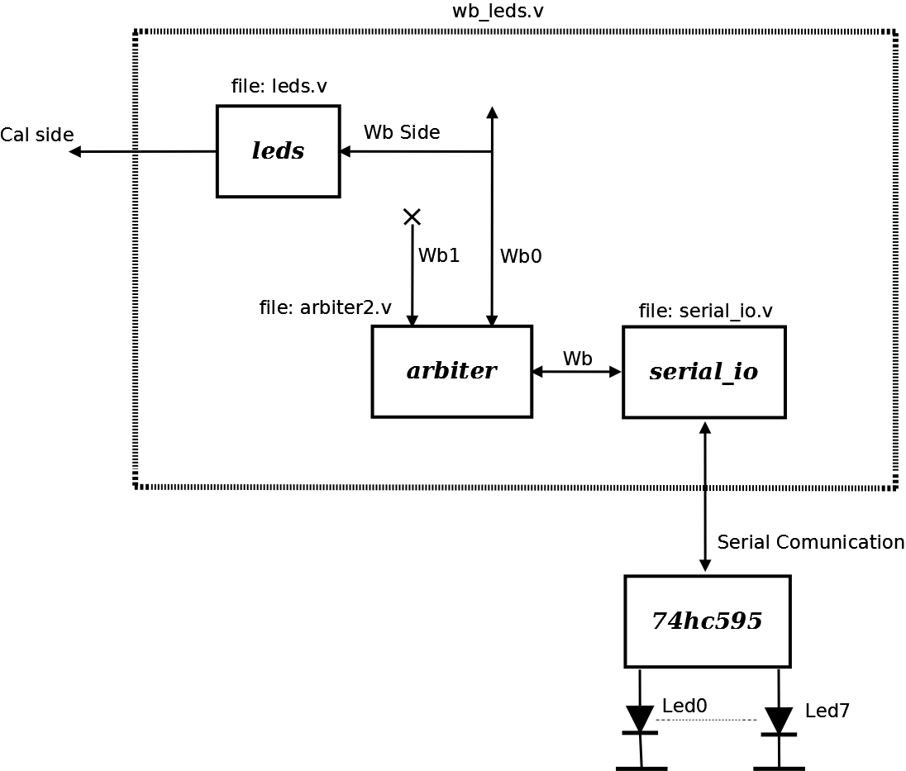

# File:Leds.png

[Download original file](../assets/uploads/Leds--4ce2f984b5.png)

Original upload: **Salva**, 2011-02-21T14:41:19Z; 50,075 bytes; `image/png`.

System Actor Leds structure

---

## Archive provenance

- [Original page](http://erika.tuxfamily.org/wiki/index.php?title=File%3ALeds.png) · [Archived source revision 2707](http://erika.tuxfamily.org/wiki/index.php?oldid=2707)
- Last source edit: 2011-02-21T14:41:19Z. Source retrieved on 2026-11-06; Markdown conversion completed on 2026-11-07.
- Original contributors recorded in exported history: Salva.
- [Original MediaWiki source](../source/wikitext/1773.mediawiki) · [Original editing history](../source/history/batch-034.xml)
- [Attribution and licensing notice](../NOTICE.md). Original file-specific notices, where present, remain applicable.
