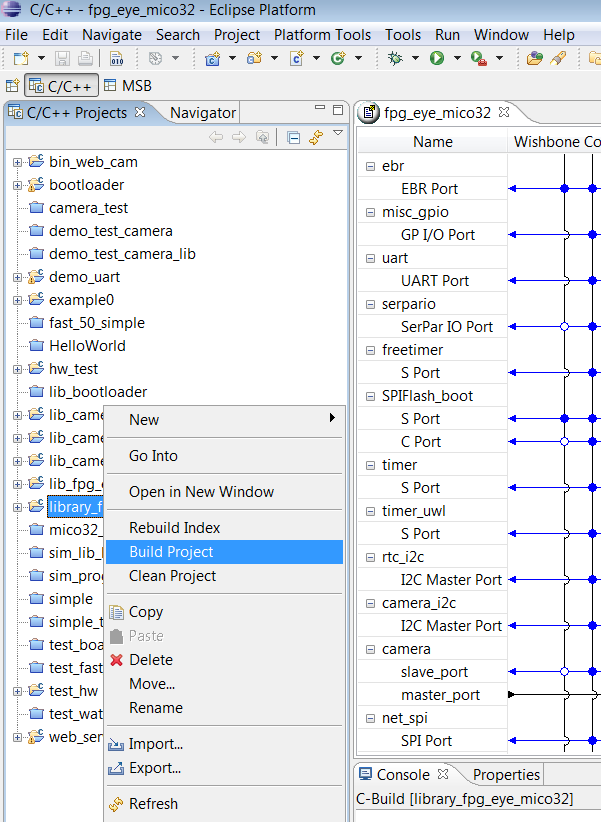

# File:Lib fpg eye mico32 build.png

[Download original file](../assets/uploads/Lib_fpg_eye_mico32_build--f44ab5a5b8.png)

Original upload: **Salva**, 2011-11-08T10:07:03Z; 76,664 bytes; `image/png`.

---

## Archive provenance

- [Original page](http://erika.tuxfamily.org/wiki/index.php?title=File%3ALib_fpg_eye_mico32_build.png) · [Archived source revision 4107](http://erika.tuxfamily.org/wiki/index.php?oldid=4107)
- Last source edit: 2011-11-08T10:07:03Z. Source retrieved on 2026-11-06; Markdown conversion completed on 2026-11-07.
- Original contributors recorded in exported history: Salva.
- [Original MediaWiki source](../source/wikitext/2182.mediawiki) · [Original editing history](../source/history/batch-034.xml)
- [Attribution and licensing notice](../NOTICE.md). Original file-specific notices, where present, remain applicable.
