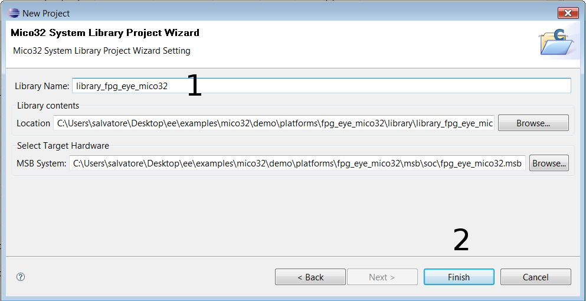

# File:Lib fpg eye mico32 name.png

[Download original file](../assets/uploads/Lib_fpg_eye_mico32_name--bfad41a0d2.png)

Original upload: **Salva**, 2011-11-08T09:36:25Z; 34,152 bytes; `image/png`.

---

## Archive provenance

- [Original page](http://erika.tuxfamily.org/wiki/index.php?title=File%3ALib_fpg_eye_mico32_name.png) · [Archived source revision 4105](http://erika.tuxfamily.org/wiki/index.php?oldid=4105)
- Last source edit: 2011-11-08T09:36:25Z. Source retrieved on 2026-11-06; Markdown conversion completed on 2026-11-07.
- Original contributors recorded in exported history: Salva.
- [Original MediaWiki source](../source/wikitext/2181.mediawiki) · [Original editing history](../source/history/batch-035.xml)
- [Attribution and licensing notice](../NOTICE.md). Original file-specific notices, where present, remain applicable.
