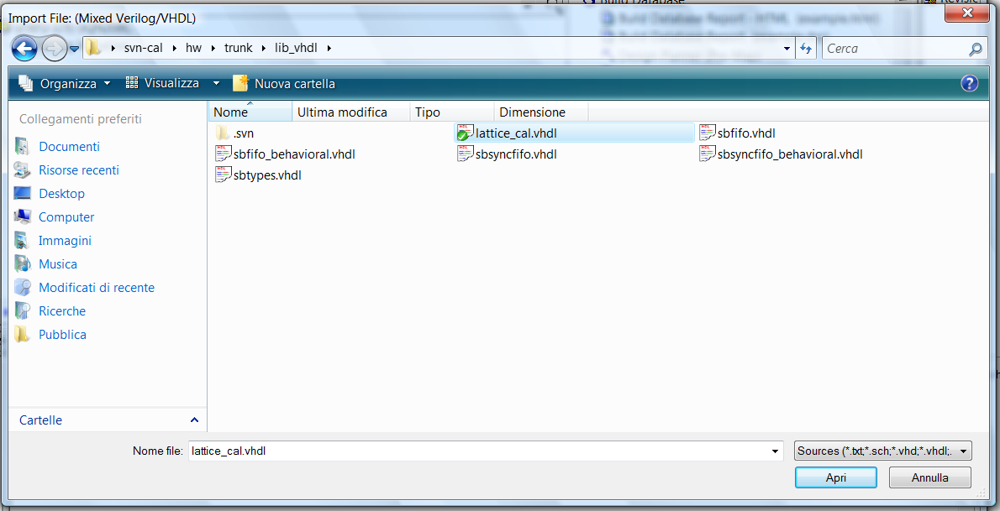

# File:Lib vhdl.png

[Download original file](../assets/uploads/Lib_vhdl--95c03502c2.png)

Original upload: **Salva**, 2011-02-15T15:11:44Z; 115,253 bytes; `image/png`.

Upload comment: Import lattice_cal.vhdl

Import lattice\_cal.vhdl

---

## Archive provenance

- [Original page](http://erika.tuxfamily.org/wiki/index.php?title=File%3ALib_vhdl.png) · [Archived source revision 2615](http://erika.tuxfamily.org/wiki/index.php?oldid=2615)
- Last source edit: 2011-02-15T15:11:44Z. Source retrieved on 2026-11-06; Markdown conversion completed on 2026-11-07.
- Original contributors recorded in exported history: Salva.
- [Original MediaWiki source](../source/wikitext/1785.mediawiki) · [Original editing history](../source/history/batch-035.xml)
- [Attribution and licensing notice](../NOTICE.md). Original file-specific notices, where present, remain applicable.
