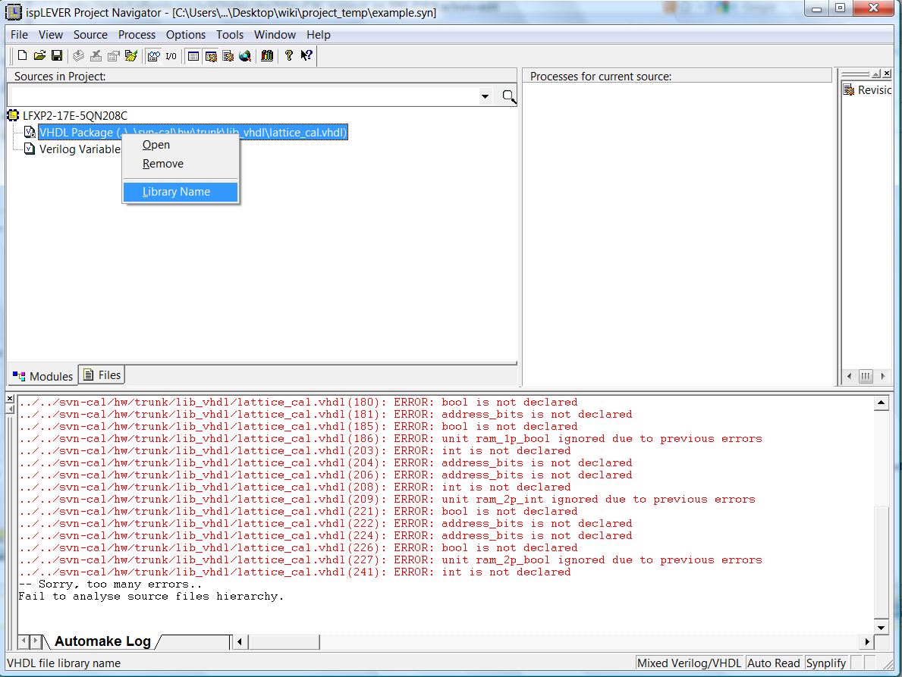

# File:Library name.png

[Download original file](../assets/uploads/Library_name--8a453e8f18.png)

Original upload: **Salva**, 2011-02-15T15:51:23Z; 93,283 bytes; `image/png`.

Upload comment: Library Name

Library Name

---

## Archive provenance

- [Original page](http://erika.tuxfamily.org/wiki/index.php?title=File%3ALibrary_name.png) · [Archived source revision 2624](http://erika.tuxfamily.org/wiki/index.php?oldid=2624)
- Last source edit: 2011-02-15T15:51:23Z. Source retrieved on 2026-11-06; Markdown conversion completed on 2026-11-07.
- Original contributors recorded in exported history: Salva.
- [Original MediaWiki source](../source/wikitext/1786.mediawiki) · [Original editing history](../source/history/batch-035.xml)
- [Attribution and licensing notice](../NOTICE.md). Original file-specific notices, where present, remain applicable.
