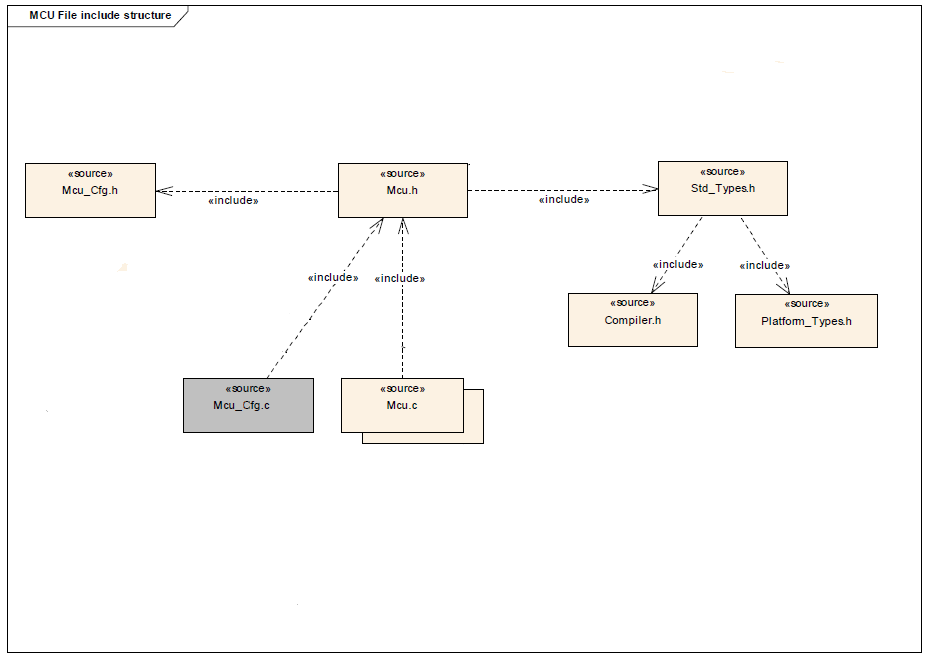

# File:MCU Driver File structure.png

[Download original file](../assets/uploads/MCU_Driver_File_structure--d466b4d0c2.png)

Original upload: **Eguidieri**, 2013-07-15T17:12:42Z; 25,249 bytes; `image/png`.

Upload comment: AUTOSAR-like MCU Driver File Structure

AUTOSAR-like MCU Driver File Structure

---

## Archive provenance

- [Original page](http://erika.tuxfamily.org/wiki/index.php?title=File%3AMCU_Driver_File_structure.png) · [Archived source revision 5134](http://erika.tuxfamily.org/wiki/index.php?oldid=5134)
- Last source edit: 2013-07-15T17:12:43Z. Source retrieved on 2026-11-06; Markdown conversion completed on 2026-11-07.
- Original contributors recorded in exported history: Eguidieri.
- [Original MediaWiki source](../source/wikitext/2353.mediawiki) · [Original editing history](../source/history/batch-035.xml)
- [Attribution and licensing notice](../NOTICE.md). Original file-specific notices, where present, remain applicable.
