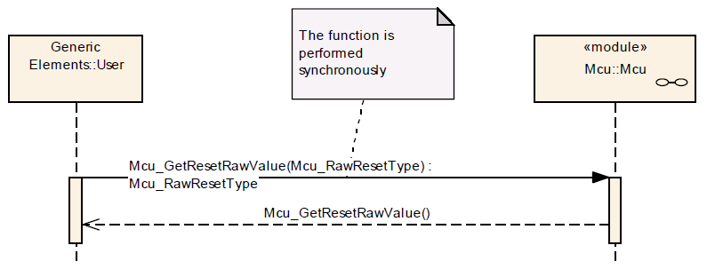

# File:Mcu GetRawResetValue Seq Diag.png

[Download original file](../assets/uploads/Mcu_GetRawResetValue_Seq_Diag--1531407809.png)

Original upload: **Giuseppe Serano**, 2013-07-16T13:00:56Z; 22,530 bytes; `image/png`.

Upload comment: Mcu_GetRawResetValue() Sequence Diagram.

Mcu\_GetRawResetValue() Sequence Diagram.

---

## Archive provenance

- [Original page](http://erika.tuxfamily.org/wiki/index.php?title=File%3AMcu_GetRawResetValue_Seq_Diag.png) · [Archived source revision 5191](http://erika.tuxfamily.org/wiki/index.php?oldid=5191)
- Last source edit: 2013-07-16T13:00:56Z. Source retrieved on 2026-11-06; Markdown conversion completed on 2026-11-07.
- Original contributors recorded in exported history: Giuseppe Serano.
- [Original MediaWiki source](../source/wikitext/2376.mediawiki) · [Original editing history](../source/history/batch-040.xml)
- [Attribution and licensing notice](../NOTICE.md). Original file-specific notices, where present, remain applicable.
