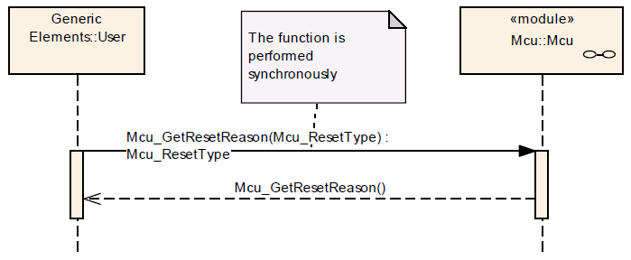

# File:Mcu GetResetReason Seq Dia.png

[Download original file](../assets/uploads/Mcu_GetResetReason_Seq_Dia--f17f0311a3.png)

Original upload: **Giuseppe Serano**, 2013-07-16T12:59:32Z; 20,048 bytes; `image/png`.

Upload comment: Mcu_GetResetReason() Sequence Diagram.

Mcu\_GetResetReason() Sequence Diagram.

---

## Archive provenance

- [Original page](http://erika.tuxfamily.org/wiki/index.php?title=File%3AMcu_GetResetReason_Seq_Dia.png) · [Archived source revision 5189](http://erika.tuxfamily.org/wiki/index.php?oldid=5189)
- Last source edit: 2013-07-16T12:59:32Z. Source retrieved on 2026-11-06; Markdown conversion completed on 2026-11-07.
- Original contributors recorded in exported history: Giuseppe Serano.
- [Original MediaWiki source](../source/wikitext/2375.mediawiki) · [Original editing history](../source/history/batch-040.xml)
- [Attribution and licensing notice](../NOTICE.md). Original file-specific notices, where present, remain applicable.
