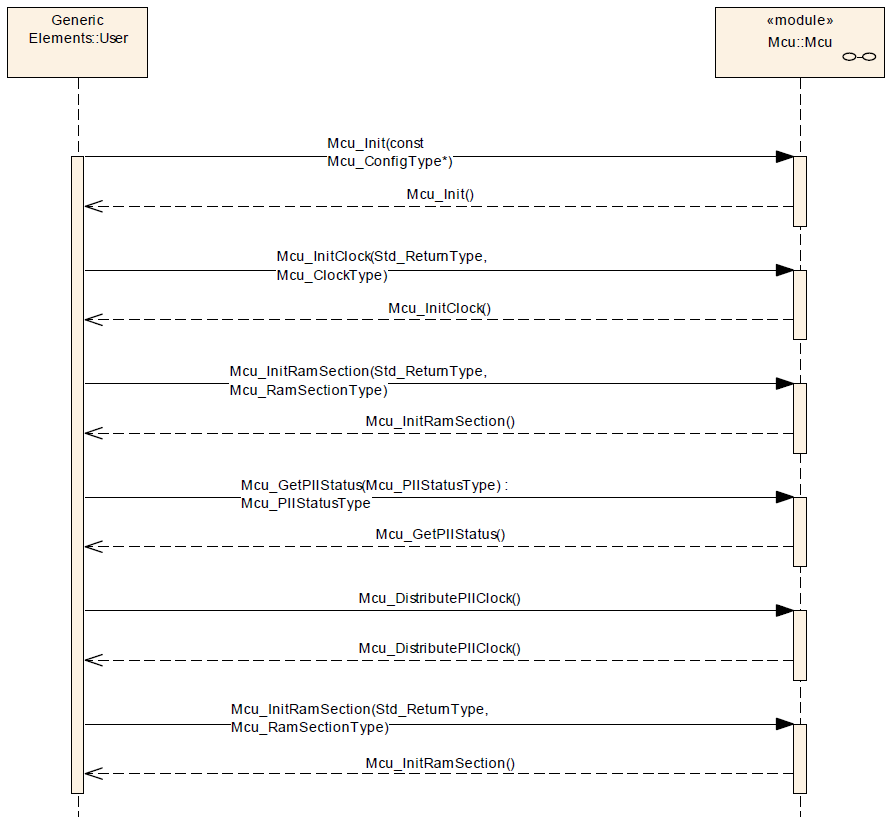

# File:Mcu Init Examples.png

[Download original file](../assets/uploads/Mcu_Init_Examples--08510f5e29.png)

Original upload: **Eguidieri**, 2013-07-16T08:45:03Z; 53,226 bytes; `image/png`.

Upload comment: MCU Initialization

MCU Initialization

---

## Archive provenance

- [Original page](http://erika.tuxfamily.org/wiki/index.php?title=File%3AMcu_Init_Examples.png) · [Archived source revision 5147](http://erika.tuxfamily.org/wiki/index.php?oldid=5147)
- Last source edit: 2013-07-16T08:45:03Z. Source retrieved on 2026-11-06; Markdown conversion completed on 2026-11-07.
- Original contributors recorded in exported history: Eguidieri.
- [Original MediaWiki source](../source/wikitext/2354.mediawiki) · [Original editing history](../source/history/batch-040.xml)
- [Attribution and licensing notice](../NOTICE.md). Original file-specific notices, where present, remain applicable.
