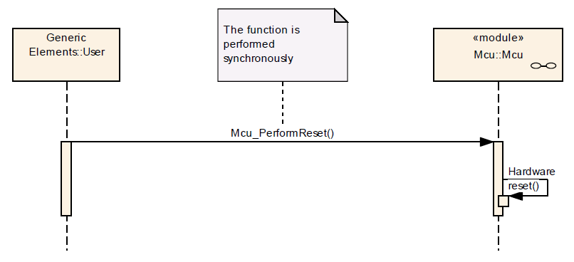

# File:Mcu PerformReset Seq Dia.png

[Download original file](../assets/uploads/Mcu_PerformReset_Seq_Dia--fba47eaaf6.png)

Original upload: **Giuseppe Serano**, 2013-07-16T13:11:12Z; 17,272 bytes; `image/png`.

Upload comment: Mcu_PerformReset() Sequence Diagram.

Mcu\_PerformReset() Sequence Diagram.

---

## Archive provenance

- [Original page](http://erika.tuxfamily.org/wiki/index.php?title=File%3AMcu_PerformReset_Seq_Dia.png) · [Archived source revision 5192](http://erika.tuxfamily.org/wiki/index.php?oldid=5192)
- Last source edit: 2013-07-16T13:11:12Z. Source retrieved on 2026-11-06; Markdown conversion completed on 2026-11-07.
- Original contributors recorded in exported history: Giuseppe Serano.
- [Original MediaWiki source](../source/wikitext/2377.mediawiki) · [Original editing history](../source/history/batch-041.xml)
- [Attribution and licensing notice](../NOTICE.md). Original file-specific notices, where present, remain applicable.
