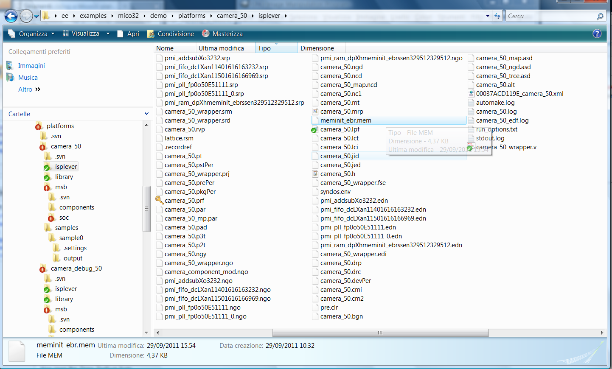

# File:Meminit ebr mem in ispLever directory.png

[Download original file](../assets/uploads/Meminit_ebr_mem_in_ispLever_directory--564bd810f7.png)

Original upload: **Salva**, 2011-10-04T15:04:23Z; 217,897 bytes; `image/png`.

---

## Archive provenance

- [Original page](http://erika.tuxfamily.org/wiki/index.php?title=File%3AMeminit_ebr_mem_in_ispLever_directory.png) · [Archived source revision 3622](http://erika.tuxfamily.org/wiki/index.php?oldid=3622)
- Last source edit: 2011-10-04T15:04:23Z. Source retrieved on 2026-11-06; Markdown conversion completed on 2026-11-07.
- Original contributors recorded in exported history: Salva.
- [Original MediaWiki source](../source/wikitext/2110.mediawiki) · [Original editing history](../source/history/batch-041.xml)
- [Attribution and licensing notice](../NOTICE.md). Original file-specific notices, where present, remain applicable.
