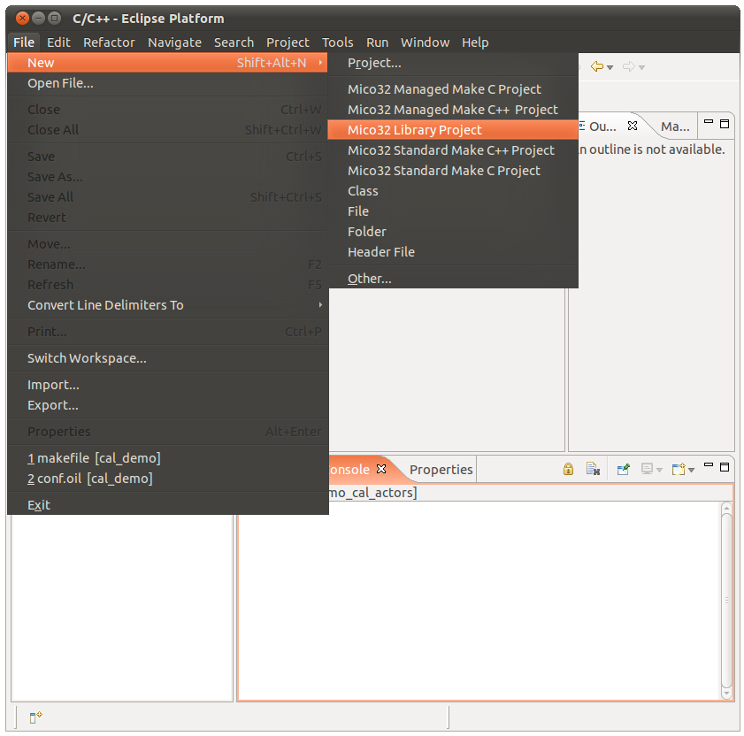

# File:Mico32 library project.png

[Download original file](../assets/uploads/Mico32_library_project--5394aeb756.png)

Original upload: **Ryosab81**, 2011-02-15T16:47:45Z; 124,691 bytes; `image/png`.

Upload comment: This screenshot shows which button has to be pressed to create a mico32 library project

This screenshot shows which button has to be pressed to create a mico32 library project

---

## Archive provenance

- [Original page](http://erika.tuxfamily.org/wiki/index.php?title=File%3AMico32_library_project.png) · [Archived source revision 2630](http://erika.tuxfamily.org/wiki/index.php?oldid=2630)
- Last source edit: 2011-02-15T16:47:46Z. Source retrieved on 2026-11-06; Markdown conversion completed on 2026-11-07.
- Original contributors recorded in exported history: Ryosab81.
- [Original MediaWiki source](../source/wikitext/1788.mediawiki) · [Original editing history](../source/history/batch-041.xml)
- [Attribution and licensing notice](../NOTICE.md). Original file-specific notices, where present, remain applicable.
